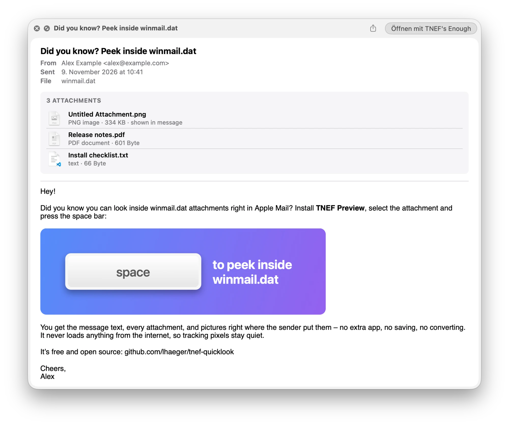

# TNEF Preview

A Quick Look extension for macOS that shows what's inside `winmail.dat` attachments. Select one in Apple Mail or Finder, press the spacebar, and you see the message text, the attachments and any pictures, without saving or converting anything first.

<p align="center">
  
</p>

The screenshot shows [`docs/winmail.dat`](docs/winmail.dat), a made-up sample mail. Once the extension is installed, select it in Finder and press the spacebar to see the same preview.

`winmail.dat` (MIME type `application/ms-tnef`) is what Outlook and Exchange send when a mail is written in Rich Text format. Apple Mail can't decode it, so you get an opaque attachment. Existing Mac tools can open these files, but none of them hook into Quick Look.

## Features

- **Mail and Finder:** press the spacebar on a winmail.dat attachment in Mail or on a saved file in Finder.
- **Message text:** HTML, compressed RTF and plain-text bodies are all supported.
- **Attachments:** each one is listed with its type and size, and images get a thumbnail.
- **Pictures in place:** images pasted into Outlook rich-text mail show up where they were in the text. Outlook stores these as OLE objects. The extension unpacks the actual picture, where other tools only give you an "Untitled Attachment". Embedded "Package" objects are unpacked to the original file too.
- **No network access:** HTML bodies are cleaned before display. Scripts, frames, forms and every remote resource (tracking pixels, external style sheets, links) are removed, so a preview never contacts a server.
- **Damaged files:** a damaged or truncated winmail.dat shows whatever could be read, plus a note about the rest.
- **Other `.dat` files:** macOS treats every `.dat` file as TNEF. The extension checks the first four bytes and leaves anything that isn't TNEF to Quick Look's normal view.

The extension only shows the contents. To save an attachment, open the winmail.dat with an extractor such as [TNEF's Enough](https://www.joshjacob.com/mac-development/tnef.php) (free). Set it as the default app for `.dat` files and a double-click in Mail opens it there.

## Requirements

- macOS 14 Sonoma or later. Developed and tested on macOS 27.
- Xcode 16 or later to build.
- [XcodeGen](https://github.com/yonaskolb/XcodeGen) (`brew install xcodegen`).

## Installation

There's no signed release yet, so you build it yourself:

```bash
git clone https://github.com/lhaeger/tnef-quicklook.git
cd tnef-quicklook
./scripts/install.sh
```

The script generates the Xcode project, builds a universal app and copies `TNEFPreview.app` to `~/Applications` (set `INSTALL_DIR` to change that). It then starts the app once, which registers the extension. Keep the app where it is: deleting it removes the extension.

If previews don't appear:

- Check that the extension is turned on under **System Settings → General → Login Items & Extensions → Quick Look**.
- Relaunch Finder (Option-right-click its Dock icon → Relaunch) and Mail. Running apps cache the extensions they have talked to, which matters after an update that changes the extension's identifier.
- Run `pluginkit -m -v -i io.github.lhaeger.TNEFPreview.QuickLook`. It should list exactly one copy, the one in `~/Applications`.

The build is ad-hoc signed, which means it runs on the Mac that built it. Copied to another Mac, Gatekeeper will likely block it.

If Xcode fails with "A required plugin failed to load", run `sudo xcodebuild -runFirstLaunch` once.

### Uninstall

Delete `~/Applications/TNEFPreview.app`, then run `qlmanage -r`.

## How it works

```
TNEFPreview.app                    host app; exists so macOS registers the extension
└── PlugIns/TNEFPreviewExtension   data-based Quick Look preview (QLPreviewProvider)
    ├── TNEFKit                    parser, Foundation only
    └── TNEFRender                 builds the HTML preview page (AppKit, ImageIO)
```

- **TNEFKit** reads the TNEF stream ([MS-OXTNEF]), including the MAPI property lists inside it. It decompresses the RTF body ([MS-OXRTFCP]) and opens OLE object attachments, which are Compound File Binary containers ([MS-CFB]), to reach the picture or file inside. Every read is bounds-checked. Damaged input either throws `TNEFError.notTNEF` or returns what was readable plus warnings; it never traps.
- **TNEFRender** builds a single HTML page with the header, the attachment list and the body:
  - Images are passed to Quick Look as `cid:` resources.
  - RTF bodies are converted with AppKit. Outlook's `\objattph` placeholders are replaced with the matching picture, matched by `PidTagRenderingPosition`.
  - HTML bodies are cleaned as described above.
- **The extension** registers for the system type `com.microsoft.tnef`. It also registers for `com.creativeinaustria.letteropener.winmail`, the type [Letter Opener](https://winmail.help) declares for the same files. While Letter Opener is installed (even from the Trash), macOS may label `.dat` files with that type instead. The extension reads four bytes before anything else and leaves files over 150 MB to the default view.

[MS-OXTNEF]: https://learn.microsoft.com/en-us/openspecs/exchange_server_protocols/ms-oxtnef/
[MS-OXRTFCP]: https://learn.microsoft.com/en-us/openspecs/exchange_server_protocols/ms-oxrtfcp/
[MS-CFB]: https://learn.microsoft.com/en-us/openspecs/windows_protocols/ms-cfb/

## Limitations

- **Attached Outlook items:** messages attached as items (for example a forwarded mail) are listed but not opened.
- **HTML wrapped in RTF:** Outlook sometimes wraps an HTML mail inside RTF. That is shown as formatted RTF text, not as the original HTML.
- **Meeting requests:** only their body text is shown.
- **Saving attachments:** Quick Look previews can't save files. Use an extractor app or the `tnef-extract` tool below.

## Development

```bash
swift test --package-path TNEFKit      # parser and renderer tests
./scripts/install.sh                   # build and install the app
```

Two command-line tools in the package help with debugging real files:

```bash
swift run --package-path TNEFKit tnef-extract winmail.dat out/       # attachments + body into out/
swift run --package-path TNEFKit tnef-render  winmail.dat page.html  # the preview page, viewable in a browser
```

`tnef-extract` produces the same output as the [`tnef`](https://github.com/verdammelt/tnef) CLI (`tnef -C out/ --save-body`), which is an easy way to check the parser against an independent implementation. One difference: OLE objects are unpacked to their contents.

The test files in `TNEFKit/Tests/TNEFKitTests/Fixtures` are synthetic and generated with:

```bash
python3 -I scripts/make_fixtures.py TNEFKit/Tests/TNEFKitTests/Fixtures
```

The sample mail in `docs/` is generated the same way, from a picture drawn by a Swift script:

```bash
mkdir -p build/demo
swift scripts/make_demo_image.swift build/demo/space-to-peek.png
python3 -I scripts/make_fixtures.py --demo build/demo/space-to-peek.png docs/winmail.dat
```

Please don't commit real winmail.dat files; they contain other people's mail.

The command-line Quick Look tester (`qlmanage -p`) crashes when it tries to load app-extension previews. To test, use Finder or Mail.

## License

[Apache License 2.0](LICENSE). Not affiliated with Microsoft or Apple.
